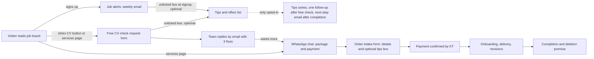
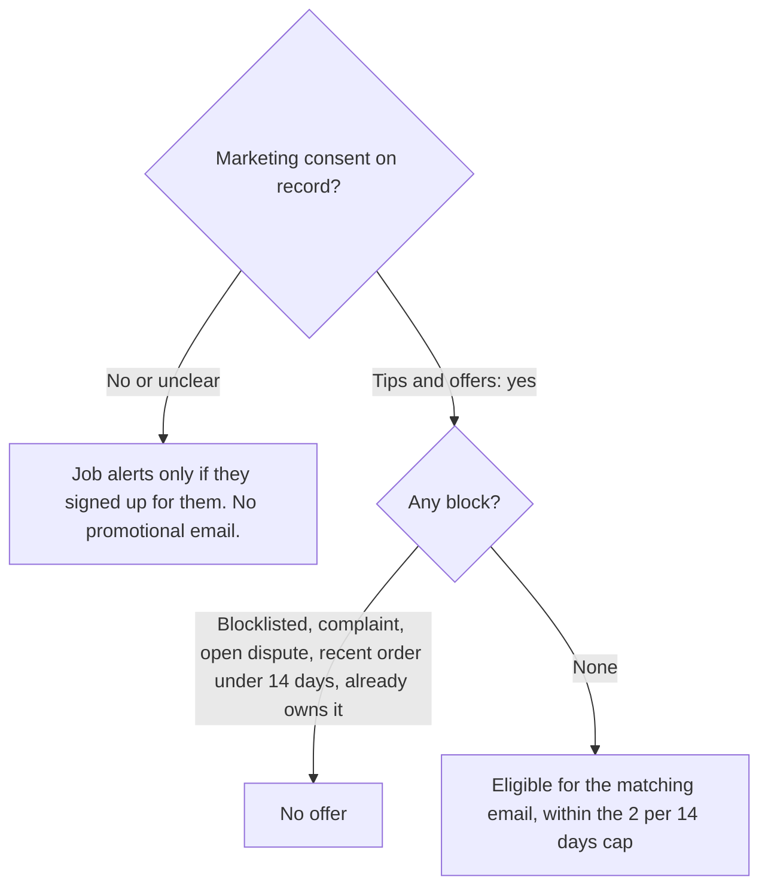

# 03 · ICPs and customer psychology

Status: PROPOSED (Phase 3 deliverable). **Every ICP here is a hypothesis.** We have no customer interviews, no conversion data and three contacts in Brevo (one is KT). The ICPs came from the brief, the board strategy decision (`drafts/decisions/2026-10-24-board-strategy-icp-inventory-seniority.md`) and the adjacent research in 02. They are working labels for writing and for deciding who should *not* get an offer; they are not boxes to put people in.

## Ground rules

1. **We cannot see who a subscriber is.** Today a signup is an email address and a source page. We do not infer anxiety, desperation, age, nationality, health, finances or any other sensitive trait from clicks or from anything else. People are only ever segmented by something they told us (for example the level they chose on a form) or by something that factually happened (they ordered a package on this date).
2. **No targeting on vulnerability.** No copy aimed at someone because they seem desperate. No "still unemployed?" retargeting. No urgency.
3. **People move between ICPs.** A graduate becomes a career changer. Treat these as angles for explaining, not as identities.
4. **At today's scale, segmentation beyond "which level do you want jobs for" is not justified.** More granular journeys wait for data (see 09).

## ICP comparison matrix

| | I1 Silent applicant | I2 Unsure of quality | I3 Entry-level entrant | I4 Busy professional | I5 Career changer | I6 Experienced, needs sharper positioning | I7 LinkedIn visibility seeker | I8 Sceptic | I9 Wants the full service |
|---|---|---|---|---|---|---|---|---|---|
| Job to be done | Get replies | Know if the CV is good enough | Look credible with little experience | Get a good CV without spending evenings | Translate old experience into a new field | Stand out among similar experience | Be found and look credible on LinkedIn | Decide if paying is worth it | Hand over the whole job-search presentation |
| Observable signal | Told us on a form or in WhatsApp | Asked for the free check | Chose "Starting out" at signup | Asked about turnaround or priority | Said so in intake | Chose "Mid-level" or "Senior" | Asked about LinkedIn on WhatsApp | Free check done, no order | Asked about Executive or Professional |
| Awareness and intent | Problem-aware, solution unclear | Solution-aware (wants a check) | Early, price-sensitive | Solution-aware, time-poor | Problem-aware | Solution-aware | Solution-aware | Solution-aware, doubtful | High intent |
| First offer | Free check | Free check | Free check, Essential | Essential, 48h priority add-on | Essential with a clear brief | Professional | Professional (profile) or Executive | None until asked; answer questions | Executive |
| Unsuitable offer | Executive on first contact | Anything before the check | Executive | Executive unless asked | Add-ons before CV done | Essential-only if they want LinkedIn | Executive if they only need a profile | Anything pushy | Essential-only pitch |
| Confidence in the ICP | Low | Low | Medium (matches board data) | Low | Low | Medium | Low | Low | Low |

Medium for I3 and I6 only because they match the two levels the board already filters on. Everything else is Low.

## ICP detail

Fields follow the brief: job, signals, awareness, pains, alternatives, why AI/templates/doing nothing may look better, what resolves doubt, appropriate and unsuitable offer, angle, next action, exit, confidence, validation.

### I1 · The silent applicant (applies, hears nothing)
- **Job and outcome:** more replies; to understand why there are none.
- **Signals (stated only):** says so in WhatsApp or the free-check form notes.
- **Pains and context:** tiring; unsure whether the CV, the roles or the market is the problem. We cannot know which, and the copy must not pretend a CV is the cause.
- **Alternatives:** change nothing; ask AI; ask a friend.
- **Why AI or nothing may look better:** free, instant, no stranger reading their CV.
- **What resolves doubt:** a free check that names three specific things in their own CV.
- **Offer:** free check; Essential only if they want us to do the fixes. **Not:** a promise that a new CV brings replies.
- **Angle:** "Here is what we noticed. You decide."
- **Next action:** request the free check. **Exit:** check delivered and no reply, or order placed.
- **Confidence:** Low. **Validate:** ask the first 10 free-check requesters what made them ask (one line in the form).

### I2 · The unsure applicant (does not know whether the CV is good)
- **Job and outcome:** a second opinion.
- **Signals:** asks for the free check.
- **Pains:** fear of wasting effort on a weak CV; no benchmark.
- **Alternatives:** AI review, templates, a friend.
- **What resolves doubt:** a concrete review, plus our honest "this part is fine".
- **Offer:** free check. **Not:** a sales message before the review is returned.
- **Angle:** honest assessment, including what to leave alone.
- **Exit:** result delivered. **Confidence:** Low. **Validate:** share of checks where we say "mostly fine" and what those people do next.

### I3 · The entry-level entrant (students and recent graduates)
- **Job and outcome:** look credible with little experience; get a first interview.
- **Signals:** chose "Starting out" on the signup form (to be added); came from an early-career job card.
- **Pains:** thin experience, many applications, price sensitivity.
- **Alternatives:** free university templates, AI, career-centre services.
- **Why free or AI may look better:** budget; strong AI habit (F4 suggests high AI use among younger workers; vendor survey, unverified).
- **What resolves doubt:** the free check; an Essential price of $29 stated plainly with what it includes.
- **Offer:** free check, Essential. **Not:** Executive, LinkedIn Growth.
- **Angle:** "Show your real work clearly", never "get hired fast".
- **Exit:** ordered, or no click in the sunset window. **Confidence:** Medium. **Validate:** compare free-check conversion by level choice after 30 checks.
- **Copy rule:** never "for students" or "for graduates" (CLAUDE.md copy rule); the wording is "starting out" or "entry-level".

### I4 · The busy professional (wants to save time)
- **Job and outcome:** a polished CV with minimal effort.
- **Signals:** asks about delivery time or the priority-delivery add-on.
- **Pains:** time, not knowing what to put first.
- **Alternatives:** do it themselves with AI.
- **What resolves doubt:** clear timeline, exactly what we need from them, two revision rounds.
- **Offer:** Essential; priority-delivery add-on (1 working day) when they state a deadline. **Not:** extras they did not ask for.
- **Angle:** "Send us the CV and the roles; we'll do the rest."
- **Exit:** order placed. **Confidence:** Low. **Validate:** share of orders choosing priority delivery.

### I5 · The career changer
- **Job and outcome:** make past experience read as relevant to a new field.
- **Signals:** says so in intake or WhatsApp (never inferred).
- **Pains:** their titles do not match the target roles; unsure what transfers.
- **Alternatives:** AI rewrites, which can over-claim.
- **What resolves doubt:** a checked, honest translation: we do not invent experience (stated on the site).
- **Offer:** Essential with a clear target-role brief; second CV add-on if they target two roles. **Not:** pressure.
- **Angle:** "Same experience, said in the language of the new role."
- **Exit:** order or no response. **Confidence:** Low. **Validate:** intake question "what roles?" (already in the order brief).

### I6 · The experienced applicant who needs sharper positioning
- **Job and outcome:** differentiate among peers with similar histories.
- **Signals:** chose "Mid-level" or "Senior and leadership" jobs.
- **Pains:** long histories; which achievements to lead with.
- **Alternatives:** keep the old CV; AI.
- **What resolves doubt:** a free check that shows we can cut and prioritise; Professional as the natural next step.
- **Offer:** Professional. **Not:** a lower-tier-only pitch when they want LinkedIn too.
- **Angle:** "Lead with what matters for the role you want."
- **Exit:** order or no response. **Confidence:** Medium. **Validate:** free-check to Professional rate by level.

### I7 · The LinkedIn visibility seeker
- **Job and outcome:** a profile that earns a second look.
- **Signals:** asks about LinkedIn on WhatsApp.
- **Pains:** not knowing what to post; time.
- **Alternatives:** AI posts; do nothing.
- **What resolves doubt:** exactly what Executive and LinkedIn Growth include and what they do not promise (no follower or impression promises).
- **Offer:** Professional (profile setup) or Executive; Growth after 30 days by arrangement.
- **Angle:** "A consistent, credible presence." **Exit:** order or decline. **Confidence:** Low.

### I8 · The sceptic (interested but doubts paying for a CV)
- **Job and outcome:** decide without being pressured.
- **Signals:** received the free check and did not order. We cannot tell why.
- **Alternatives:** AI, templates, nothing.
- **What resolves doubt:** an honest comparison, including when AI is enough (CT-2, CT-3 in the copy library).
- **Offer:** none by email unless they opted in; no second sales email.
- **Angle:** "Here is how to decide." **Exit:** one follow-up email, then silence. **Confidence:** Low. **Validate:** reply rate to the follow-up.

### I9 · The person who wants the whole service
- **Job and outcome:** hand the whole presentation over.
- **Signals:** asks about Executive.
- **What resolves doubt:** scope, 30-day timeline, content approval, what we do not promise.
- **Offer:** Executive. **Not:** upselling beyond what they asked.
- **Exit:** order. **Confidence:** Low.

## Customer journey diagrams

### Journey 1: from the job board to an order (who acts: you, us, or the system)

### Journey 2: what each person is and is not eligible for

The first node is the heart of the design: nobody enters a promotional journey because they exist in the system; only an unticked-then-ticked box, with a record, opens the door.
