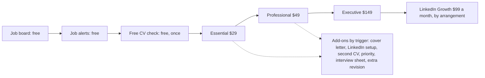

# 04 · Positioning, value ladder and offer eligibility

Status: PROPOSED (Phase 4 deliverable). Labels: **Verified** (on the live site or repo), **Hypothesis** (plausible, untested), **Recommendation**. We have no customer outcome data, so nothing here claims a result.

## The ten questions, answered

### 1. Why should someone buy a $29 CV rather than use AI?

Honest answer first: **many people should not, and the email should say so.** AI is free or cheap, fast, and good at producing a clean draft. The research we found says writing help does help applicants (F1), so writing is not what we sell.

What a person pays $29 for (all **hypotheses**, to test in interviews):
1. **Someone accountable looks at it.** A person decides what to cut, what to lead with, and what the target role will care about, and answers for the result.
2. **Facts stay true.** Our published rule is that we do not invent achievements, qualifications or results (verified on the site). AI tools can produce confident text that is wrong about your own history; you have to catch it.
3. **A finished package, not a draft.** Word and PDF, formatted, two revision rounds, delivered by email (verified: Essential includes these).
4. **Effort and nerves.** You send a CV and the roles; someone else does the iterating.
5. **Specificity.** F2 suggests generic AI text loses signal value as more people use it; a CV built for one named role is harder to mistake for a template.

What to say when AI is enough: "If you're comfortable iterating with an AI tool and checking every line yourself, you may not need us." Saying this is more honest and, as a hypothesis, more trustworthy to a sceptic (ICP I8). It is not a tested claim.

### 2. Which aspects of Yireh Careers create defensible value?

| Aspect | Defensible? | Why |
|---|---|---|
| Quality of writing | No | AI matches it for many people (F1) |
| Human judgement and accountability | Partly | Real, but copyable and unproven for us |
| Fact-checking against the person's real history | Partly | A rule we can keep and show |
| Verified job board next to the service ("Get a CV for this role") | **Yes, relatively** | Nobody sells a CV service attached to a board where every listing links to the employer's own posting (verified); the role context makes the CV specific |
| Price and clarity (three packages, plain scope) | Partly | Low price and no hidden terms; competitors differ widely (F5, context only) |
| Trust and responsiveness | Yes, if earned | Replies from a person on WhatsApp and email; consistent delivery |

### 3. How can that value be demonstrated honestly?

1. **The free check** is the demonstration: three specific things in *their* CV, not a generic list (F6: a sample must itself show quality).
2. **Say what we do and do not do** in plain words (CT-3).
3. **Real before-and-afters, only with permission and only real ones.** We have none today; we will not invent any. Collect them after the first customers, with written permission, first name only.
4. **Real testimonials** only with explicit permission, never edited into claims about outcomes.
5. **No result claims.** No "get more interviews". The site already says we do not promise interviews or offers.

### 4. Why would an Essential buyer choose Professional or Executive?

When the extra thing is something they need, not because they were nudged.

| Package | Right when | Wrong when |
|---|---|---|
| Essential $29 | They need a CV | They also need LinkedIn or a letter |
| Professional $49 | The roles ask for a cover letter, or their LinkedIn profile is thin or missing and employers will look | They only need a CV |
| Executive $149 | They want a personal-branding strategy, 12 posts and 30 days of targeted connection building, and understand there are no promised results | They want one document |

The decision is made in conversation on WhatsApp at order time (a human), not by an automated email. Emails only repeat the facts for people who opted in.

### 5. When is an add-on useful rather than an unnecessary upsell?

An add-on is offered **only when a factual trigger exists** that the customer told us or that we can see in our own records.

| Add-on | Useful trigger | Not useful |
|---|---|---|
| Cover letter $15 | The posting asks for one | No letters requested |
| LinkedIn profile setup $25 | They have no profile or told us it is outdated | They said their profile is fine |
| Extra revision $10 | Both included rounds are used and they want another | Rounds unused |
| Second CV $15 | They named two target roles | One role |
| 48-hour priority $15 | They gave a deadline | No deadline |
| Interview preparation sheet $29 | They told us they have an interview | Nothing scheduled |

No blanket "add this now" messages. No countdowns.

### 6. Why might a previous customer buy another CV for a different role?

Because their target changed (new field, promotion path, relocation). **We cannot detect that**; only they know. So the second-CV offer appears in two places: the services page, and one line in the opted-in "what comes next" email (CU-1) framed as "if your target changes". It is never in a service email.

### 7. When might interview preparation or LinkedIn support become relevant?

- **Interview sheet:** when the customer says an interview is scheduled. Not inferred.
- **LinkedIn:** when they ask, when they bought Professional but not the LinkedIn Growth plan and opted in, or at the end of Executive (day 30), because the published terms describe LinkedIn Growth as the way to continue.

### 8. When should we make no further offer?

Make **no** offer when any of these is true:
- No marketing consent on record, or the record is unclear or old.
- Blocklisted, unsubscribed, or complained.
- An open revision, dispute or refund conversation.
- An order completed less than 14 days ago (let the work land).
- They already have the thing.
- They declined once (record it, do not re-ask for 90 days).
- An Executive 30-day service is in progress (service, not selling).
- They already received 2 promotional emails in the last 14 days.
- Their free check is done and they did not opt in: the check reply itself is the last message.

### 9. What should a satisfied customer receive after delivery?

1. The files, with a two-line how-to-use note.
2. Clear next step for revisions and a date by which revisions are included.
3. The deletion promise stated once (90 days).
4. A short "did everything arrive?" check from a person.
5. An easy way to leave a line of feedback, framed as improving our service, with a clear "yes, you may share it" or "no" (permission-based).
6. Nothing else. No upsell in this email (see 08, RK-6).

### 10. Role of referrals, repeat business and long-term relationships

- **Referrals:** invite, never reward (F8 is mixed; incentives raise consumer-law and disclosure questions). One line: "If a friend needs a hand, they can message us." Only in opted-in emails. Never in a service email.
- **Repeat business:** CV needs come in episodes, not on a schedule; we do not know the interval and will not guess. A quiet tips list is the relationship.
- **Long-term:** the job board is the long-term asset (free, useful weekly); services are bought when needed. LinkedIn Growth is the only ongoing paid service, by arrangement, month to month.

## Objection analysis

| Objection | Honest reply | Where it lives |
|---|---|---|
| "AI does this free." | "It can, and for some people that's the right call. Here's what a person adds, and here's how to check an AI draft yourself." | CT-2, CT-3 |
| "$29 for a stranger to see my CV?" | "Free check first. We delete your CV within 30 days if you don't order." | OP-1, free-check page |
| "How do I know it'll work?" | "We can't promise interviews or offers, and we won't. We promise a clear, accurate, role-specific CV." | CT-3 |
| "I don't have time." | "Send the CV and roles; we do the rest." | Essential order intake |
| "I'm not sure my CV is bad." | "The check will tell you, including what to leave alone." | CT-1 |
| "Why Professional?" | By need, in the WhatsApp chat | OP-3 |

## Value ladder

People can enter at any rung. Nobody is walked through the ladder.

## Offer-eligibility matrix

Consent required for promotional email: **Tips and offers = yes** (see 07). WhatsApp conversations are service conversations and are not governed by this matrix.

| Audience state | May receive by email | Earliest point | Rationale | Exclusions |
|---|---|---|---|---|
| Job-alert subscriber only | Weekly digest; welcome; dormant check | At signup | Consented to that only | No CV-service content of any kind |
| Tips opt-in, no free check | Tips series (CT-1 to CT-3), monthly tips | At signup | Separate consent | Cap 2 per 14 days |
| Free check requested, no tips opt-in | Service replies only (OP-1, OP-2) | At request | Needed for the request | No follow-up promotion |
| Free check requested, tips opt-in | The above plus FC-1 (one email) | 4 days after the result | Consent plus a factual trigger | No second follow-up |
| Customer, no tips opt-in | Service emails only | Order stages | Contract | No promotion; deletion at 90 days |
| Customer, tips opt-in | CU-1 (21 days after completion), CU-2 (60 days) | After completion | Consent plus a factual trigger | None within 14 days of completion; not during open disputes; not Executive in progress |
| Executive, day 30 | Service update that states the Growth continuation as per published terms | Day 30 | Contract terms | Legal review on the single sentence (08, RK-6) |
| Dormant (no click 90 days) | One "still want these?" email | After 90 days | Within original consent | Then stop sending |
| Blocklisted / complained | Nothing | n/a | Law and trust | Never reactivated by another form |
