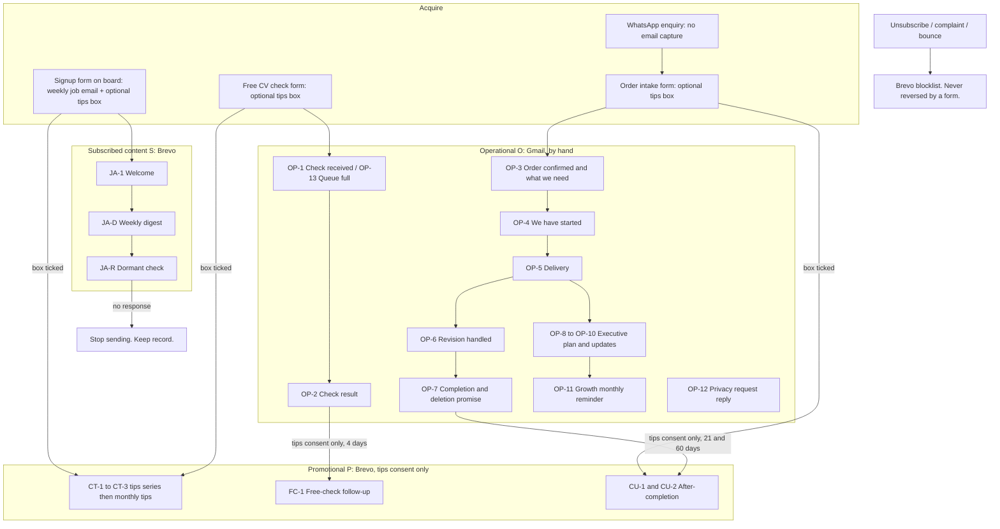

# 05 · Funnel, journey and automation architecture

Status: PROPOSED (Phase 5 deliverable). Email ids refer to `11-email-inventory.md` and the copy in `copy/`.

## Classification used everywhere

| Class | Meaning | Sent from | Needs marketing consent? |
|---|---|---|---|
| **S** Subscribed content | The thing the person signed up for (weekly job email) | Brevo | Consent for **job alerts** |
| **P** Promotional or relationship | CV-service tips, offers, follow-ups, referral invitation | Brevo | Consent for **tips and offers**, separate |
| **O** Operational | Needed to deliver a service the person asked for or paid for | Gmail (yirehcareers@gmail.com), by hand | No marketing consent, **and may not contain promotion** |

## Lifecycle map

## What is deliberately not built

| Idea | Decision | Why |
|---|---|---|
| Follow-up on an abandoned WhatsApp enquiry | **Not built** | The event is not observable (we do not see who chatted and left); we do not have their email; messaging them first on WhatsApp has policy and consent questions not verified here |
| Cart or checkout abandonment emails | Not built | Checkout is off; no payment webhook |
| Automatic "payment confirmed" triggers | Not built | A WhatsApp message is not proof of payment; KT confirms payment and records it (07) |
| Behaviour-scored segments, lead scoring | Not built | Three contacts; no basis; privacy cost |
| Promotional content in service emails | Never | See classification above |
| A sales email after a free check for people who did not opt in | Never | The check reply is the last message |

## Journey specifications

Eleven journeys. Fields: trigger, eligibility, consent, timing, objective, messages, exit, suppression, dependencies, failure path, measurement.

### J1 · Job-alert signup and weekly digest (class S)
- **Trigger:** person submits the board signup form (Brevo adds the contact to list "Job alerts").
- **Eligibility:** valid email; not blocklisted.
- **Consent:** job alerts. The form says what it is: the weekly job email.
- **Timing:** JA-1 immediately. Digest weekly, one fixed day (start Tuesday morning; compare another day only when list is large enough to read a difference, see 09).
- **Objective:** deliver the thing promised; build a habit of using the board.
- **Messages:** JA-1, JA-D (generated by `scripts/make_digest.py`).
- **Exit:** unsubscribe, bounce, complaint, or the dormant rule (J10).
- **Suppression:** blocklist (global).
- **Dependencies:** Brevo form working; sender identity; the jobs feed.
- **Failure path:** the signup page must show an error if Brevo rejects (replace the false-success message); if the digest is late, skip the week, do not double-send.
- **Measurement:** signups, clicks per send, unsubscribes per send, spam complaints.

### J2 · Tips and offers signup (class P)
- **Trigger:** unticked box ticked at one of three forms (signup, free check, order intake) → contact added to list "Career tips" and attribute `CONSENT_TIPS_AT` set.
- **Eligibility:** box ticked by the person, on a form whose wording version is recorded.
- **Consent:** tips and offers (separate from J1).
- **Timing:** CT-1 immediately; CT-2 on day 6; CT-3 on day 13; then at most one monthly tip.
- **Objective:** teach something useful each time; help the person decide whether they want help. One CTA per email.
- **Exit:** unsubscribe; or free-check request (they act, series stops); or order (series stops).
- **Suppression:** blocklist; list removal.
- **Failure path:** if a contact is on the tips list with no recorded consent, a weekly audit script flags it (06) and the contact is removed from the list until resolved.
- **Measurement:** tips opt-in rate per form, link clicks to the free-check form, unsubscribes after each email.

### J3 · Free CV check (class O, with one optional P email)
- **Trigger:** person submits the free-check form (name, email, target role, optional WhatsApp); optional tips box.
- **Eligibility:** one per person; within the weekly cap (KT sets it; the site says "a limited number each week").
- **Consent:** none needed for the check itself (a request they made); tips box is separate.
- **Timing:** the page they land on after submitting tells them to email the CV and what happens next; KT sends OP-1 (or OP-13 if full) within 1 working day; OP-2 result within the promised time (to be stated on the site: **KT to confirm** the turnaround).
- **Optional P:** FC-1 four days after OP-2, only if tips consent.
- **Exit:** result sent and no tips consent: done. FC-1 sent: done.
- **Failure path:** if the CV has not arrived in 7 days, KT may send one "Did it come through?" reply in the same thread. Beyond that, nothing; the 30-day deletion rule applies.
- **Measurement:** requests per week, turnaround, share asking for a package, share that order (needs the register).

### J4 · Enquiry and WhatsApp handoff (class O, manual)
- **Trigger:** person messages on WhatsApp.
- **What exists:** a prefilled message from site buttons; the WhatsApp library in `drafts/whatsapp-messages.md`.
- **What does not:** an email address, until they send one.
- **Consent:** none required to reply to their message.
- **Measurement:** KT logs source (prefilled text carries a short code such as `from:tips-3`) and outcome in the enquiry log.
- **Failure path:** none automated.

### J5 · Order → payment → onboarding → delivery → revisions → completion (class O)
- **Trigger:** order agreed on WhatsApp; the **order intake form** (email, package, target roles, optional tips box) is sent to the customer; **payment confirmed by KT** after checking the real payment (bank, crypto or Whop) and recorded in the register.
- **Messages (Gmail):** OP-3 order confirmed and what we need; OP-4 we have started (with dates); OP-5 delivery; OP-6 revision handled; OP-7 completion and deletion promise.
- **Eligibility:** payment recorded.
- **Consent:** none for service emails; **no promotion inside any of them**.
- **Timing:** OP-3 same day as payment; OP-4 when onboarding is complete; OP-5 on delivery; OP-7 when revisions are done or the customer approves.
- **Exit:** completion. Delete-by date set at 90 days.
- **Failure path:** missing information: one reminder in the same thread after 3 working days, one more after 7, then pause the order and tell the customer plainly (service communication).
- **Measurement:** days from payment to delivery; revisions per order; messages to complete.

### J6 · Executive (class O)
- **Trigger:** Executive onboarding complete (the 30 days start then; verified on the site and in CLAUDE.md).
- **Messages (Gmail):** OP-8 branding plan for approval; OP-9 weekly update (four of them: days 7, 14, 21, 28); OP-10 day-30 final update.
- **Consent:** none; no promotion except the single published-terms sentence in OP-10 about LinkedIn Growth (legal review RK-6).
- **Failure path:** a missed approval pauses publishing and is stated plainly; no auto-publish.
- **Measurement:** posts published against 12; milestones on time.

### J7 · LinkedIn Growth (class O for reminders)
- **Trigger:** customer agrees to start Growth on WhatsApp (by arrangement; nothing automatic).
- **Messages:** OP-11 a short reminder a few days before each month starts: "Same again next month, or stop here?"
- **Consent:** none for the reminder (contract). The *offer* to start Growth is P and only goes to opted-in customers or happens in conversation.
- **Failure path:** no reply means no renewal. Nothing is charged automatically.

### J8 · After-completion relationship (class P)
- **Trigger:** `COMPLETED_ON` set by KT and tips consent on record (list "Career tips").
- **Messages:** CU-1 at 21 days (a calm "what comes next", contextual by package; first line states what they bought); CU-2 at 60 days ("How's the search going", forward-to-a-friend line, no reward).
- **Eligibility:** the exclusions in 04 question 8.
- **Exit:** unsubscribe; any new order; any complaint.
- **Measurement:** clicks, replies, add-on orders (register), unsubscribes.

### J9 · Satisfaction and feedback (class O)
- **Trigger:** a few days after OP-7.
- **Message:** OP-7 includes "tell us how it went" framed as service quality. A review or testimonial is never required, and permission to share is asked in the reply, never assumed.
- **Why O and not P:** it asks about the service they bought and carries no offer. Marked for legal review (RK-6) because feedback requests are treated as marketing in some regulators' views.

### J10 · Dormant subscribers (class S)
- **Trigger:** manual quarterly sweep. A segment "no click and no open-or-click activity in 90 days" (opens unreliable, so clicks only). Free plan, small list: a quarterly manual send is simpler than an automation.
- **Message:** JA-R: one email, one button ("Yes, keep them").
- **Exit:** click → stays; no click in 14 days → stop sending (contact kept as unengaged, not deleted, until the retention rule applies).
- **Failure path:** do not delete a contact for inactivity before the stated retention period; do not re-enrol anyone.

### J11 · Unsubscribe, complaint, suppression and deletion (class O)
- **Trigger:** unsubscribe link click, reply "stop", WhatsApp "stop", complaint, hard bounce, or a deletion request.
- **Rules:** see 07 section "Suppression and deletion"; unsubscribes honoured within 2 days, target same day; a form or import never clears a blocklist.
- **Messages:** OP-12 acknowledge a privacy request within the month limit (verified in the privacy page); no marketing contact afterwards.

## Automations that will exist in Brevo (and what stays manual)

| Item | Type | Why |
|---|---|---|
| AU-1 Job-alert welcome (JA-1) | Automation, trigger "contact added to list: Job alerts" | One email, immediate |
| AU-2 Tips series (CT-1 to CT-3) | Automation, trigger "contact added to list: Career tips" | Three timed emails |
| AU-3 Free-check follow-up (FC-1) | Automation, trigger "contact added to list: Check result sent", with entry condition "also in Career tips" | One email, 4 days after |
| AU-4 After-completion (CU-1, CU-2) | Automation, trigger "contact added to list: Order completed", with entry condition "also in Career tips" | Two emails, days 21 and 60 |
| Weekly digest | Scheduled campaign (manual) | Content changes weekly |
| Monthly tip | Scheduled campaign (manual) | Same |
| Dormant sweep | Manual campaign to a segment, quarterly | Too small for automation |

Two small "marker" lists, **Check result sent** and **Order completed**, exist only to trigger AU-3 and AU-4. Membership of a marker list means nothing about consent. This is stated on the list and enforced by the automations' entry conditions (verify the condition step exists on the Free plan, 06 test T4).
